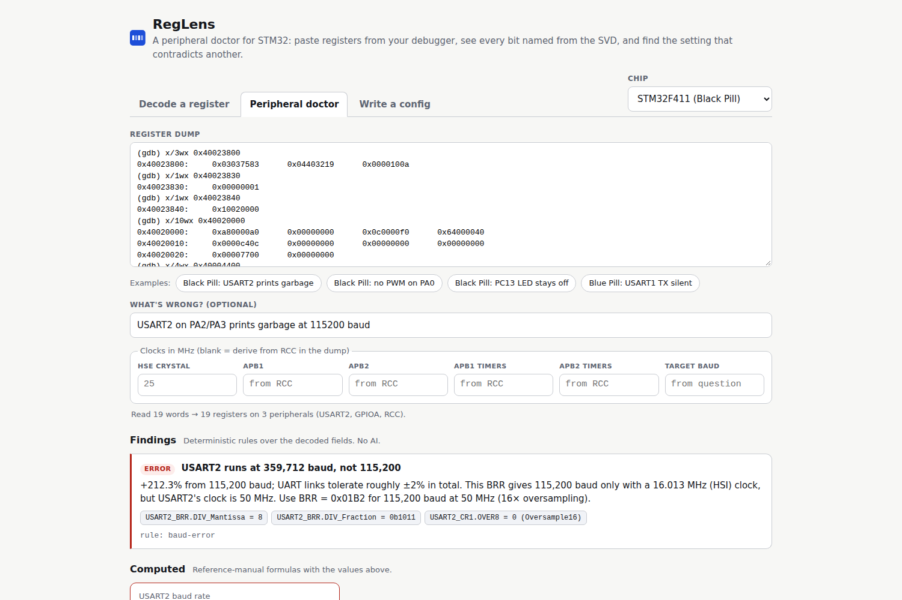

# RegLens

**A peripheral doctor for STM32.** Paste a register dump from GDB and RegLens names every bit from the chip's SVD, finds the register that contradicts another (clock gated off, pin on the wrong alternate function, BRR computed for the wrong clock), and computes the real baud rate and PWM frequency.
**Ask it for a setup in plain English** and the AI proposes register values and C, which RegLens decodes and marks *Verified* or *Not verified* before you see them.
No IDE, no hardware connection, no sign-in: it works from a pasted log, and every view is a shareable link.

**Live:** https://reglens-five.vercel.app · [Black Pill USART2 example](https://reglens-five.vercel.app/#doctor/stm32f411/eyJ0IjoiKGdkYikgeC8zd3ggMHg0MDAyMzgwMFxuMHg0MDAyMzgwMDpcdDB4MDMwMzc1ODNcdDB4MDQ0MDMyMTlcdDB4MDAwMDEwMGFcbihnZGIpIHgvMXd4IDB4NDAwMjM4MzBcbjB4NDAwMjM4MzA6XHQweDAwMDAwMDAxXG4oZ2RiKSB4LzF3eCAweDQwMDIzODQwXG4weDQwMDIzODQwOlx0MHgxMDAyMDAwMFxuKGdkYikgeC8xMHd4IDB4NDAwMjAwMDBcbjB4NDAwMjAwMDA6XHQweGE4MDAwMGEwXHQweDAwMDAwMDAwXHQweDBjMDAwMGYwXHQweDY0MDAwMDQwXG4weDQwMDIwMDEwOlx0MHgwMDAwYzQwY1x0MHgwMDAwMDAwMFx0MHgwMDAwMDAwMFx0MHgwMDAwMDAwMFxuMHg0MDAyMDAyMDpcdDB4MDAwMDc3MDBcdDB4MDAwMDAwMDBcbihnZGIpIHgvNHd4IDB4NDAwMDQ0MDBcbjB4NDAwMDQ0MDA6XHQweDAwMDAwMGMwXHQweDAwMDAwMDAwXHQweDAwMDAwMDhiXHQweDAwMDAyMDBjIiwicSI6IlVTQVJUMiBvbiBQQTIvUEEzIHByaW50cyBnYXJiYWdlIGF0IDExNTIwMCBiYXVkIiwiaCI6IiIsImExIjoiIiwiYTIiOiIiLCJ0MSI6IiIsInQyIjoiIiwiYiI6IiJ9)



Built for [Devpost Build With AI: Basics](https://learn-ai-basics.devpost.com/). Planning docs, generated with the hackathon's [skill pack](https://github.com/challengepost/learn-ai-basics): [scope](devpost/scope.md), [PRD](devpost/prd.md), [spec](devpost/spec.md).

## Why not the IDE register view?

VS Code Cortex-Debug, STM32CubeIDE's SFR view and PyCortexMDebug already decode registers from SVD files. RegLens does something they don't:

- **Cross-register diagnosis.** An SFR view shows one peripheral's bits. RegLens reads RCC, GPIO and the peripheral together and says which setting breaks another, citing the exact fields: `GPIOA_AFRL.AFRL0 = 2 selects TIM5_CH1; TIM2_CH1 on PA0 is AF1`.
- **The numbers you'd compute by hand.** Clock tree from `RCC_CFGR`/`RCC_PLLCFGR`, then USART baud and error from BRR, timer PWM frequency and duty from PSC/ARR/CCR, each with the formula shown.
- **No IDE or debug session needed.** Paste a GDB or OpenOCD log, a CI test log, or lines a teammate posted in chat.
- **Shareable.** The whole view lives in the URL, so a link reproduces exactly what you saw.
- **Checked AI.** Explain summarizes only what the decoder found, and Write proposals are verified by the decoder before they're shown.

## What it does

| Tab | Input | Output |
| --- | --- | --- |
| **Peripheral doctor** | GDB `x/Nwx`, OpenOCD `mdw`, `p/x *GPIOA`, or `GPIOA->MODER = 0x...` lines, mixed | Findings with field citations, computed baud/PWM, clock tree, every decoded register, optional AI summary |
| **Write a config** | "PA5 push-pull output, no pull", "USART2 115200 baud at 50 MHz APB1" | AI-proposed field values and C, with the checks RegLens ran and a Verified / Not verified badge |
| **Decode a register** | One register name and value | Reference-manual style bitfield figure, named values, changed-from-reset and reserved-bit markers, click-to-flip |

The doctor's rules, all deterministic:

| Rule | Example finding |
| --- | --- |
| Peripheral clock off in RCC | `RCC_AHB1ENR.GPIOCEN = 0`, so GPIOC reads 0 and ignored its configuration |
| Pin routed to the wrong alternate function (F4/H7), or a general-purpose output instead of AF (F103) | PA0 selects AF2 (TIM5_CH1), not TIM2_CH1 (AF1) |
| Output pin left in input mode | `ODR12 = 1` but `MODER12 = 0b00 (Input)` |
| Peripheral, channel or timer output not enabled | `CR1.UE = 0`, `CCER.CC1E = 0`, `TIM1_BDTR.MOE = 0` |
| Baud rate more than 2% off | 359,712 baud vs 115,200; BRR was right only for a 16 MHz clock |

Chips: STM32F103 (Blue Pill), F407 (Discovery), F411 (Black Pill), H743 (Nucleo). Old links such as `#stm32f407/GPIOA_MODER/0xABFFF3FF` still open the decoder.

## Run it

Requires Node 22.18 or newer.

```bash
npm install
cp .env.example .env    # optional: add a free NVIDIA_API_KEY to enable Explain and Write
npm run dev             # http://localhost:5173
npm test                # Vitest unit tests
```

Everything except Explain and Write works without a key. Get a free key (starts with `nvapi-`) at [build.nvidia.com](https://build.nvidia.com). The key is read only by the server functions in `api/` and never reaches the browser. Deploying to Vercel needs no configuration beyond the optional `NVIDIA_API_KEY`.

## How it works

Decoding, the rules and the clock math are plain TypeScript over SVD data, shared by the browser and the server. The AI (NVIDIA Nemotron) only explains decoder output or proposes values that the decoder then checks. Details: [docs/how-it-works.md](docs/how-it-works.md).

## Data

Register data comes from the [stm32-rs](https://github.com/stm32-rs/stm32-rs) patched SVDs, which add named field values to ST's CMSIS-SVD files. Alternate-function pin numbers are a short hand-entered table from the chip datasheets. See [data/svd/NOTICE.md](data/svd/NOTICE.md). Always confirm critical settings against the reference manual. Not affiliated with STMicroelectronics.

## AI disclosure

Built with AI coding assistance (Claude Code). The planning docs were generated with the Devpost Learn skill pack's interview skills and the code was written with Claude; both were reviewed by the author. At run time, Explain and Write call NVIDIA's hosted Nemotron models; their output is checked by RegLens's deterministic decoder before it is shown.

## License

MIT for RegLens's code. SVD data files keep their upstream terms.
